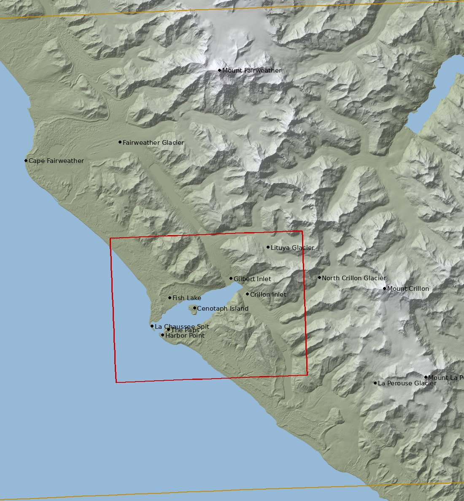
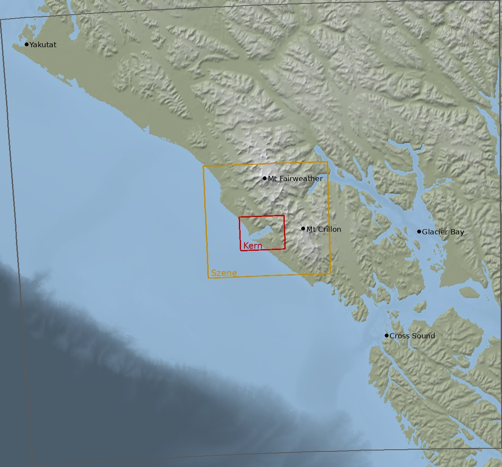
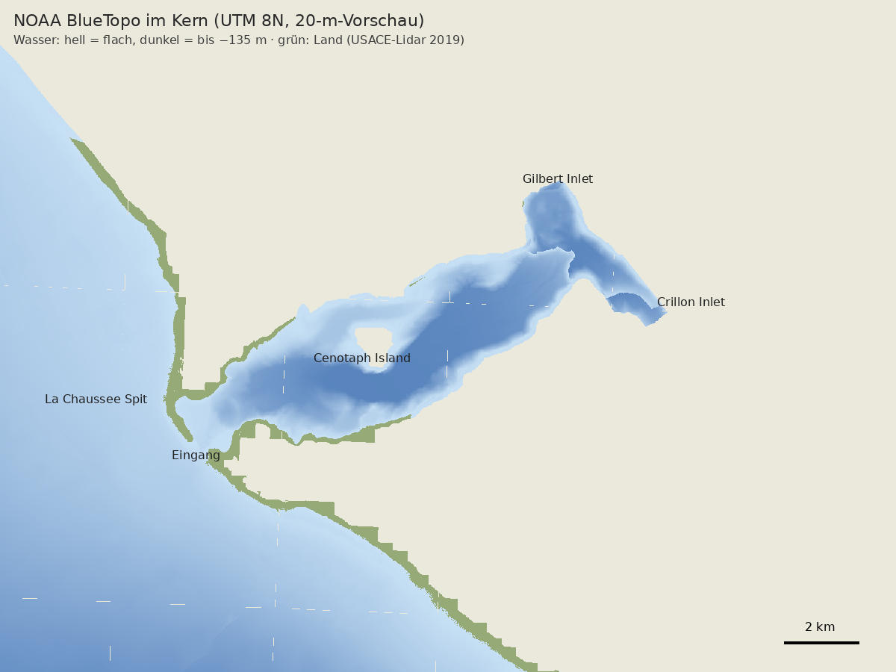

# Lituya Bay 1958 – Kartenmaterial

Sammlung der Karten, Höhenmodelle, Vermessungen, Bilder und Berichte für die Szene der Welle vom 9. Juli 1958. Geladen wird mit dem Werkzeug `tools/kartenmaterial/` (Python 3 ohne Fremdpakete) in den Ordner `download/`. Die Daten selbst stehen nicht im Repository. Mitgeführt werden das Inventar `download/INVENTAR.md`, die Gebiete und die Ortsnamen in `geodaten/`.

Stand: 01.11.2026 · 48 Quellen in 13 Gruppen · 34 Standard, 7 groß (nur mit `--gross`), 7 mit Anmeldung oder von Hand · erster Lauf auf dem eigenen Rechner: 1 170 Dateien, 12,6 GB

## 1. Gebiete (BBox)

Alle Gebiete liegen in **UTM Zone 8 Nord** (EPSG:26908, NAD83; EPSG:32608, WGS84, weicht um weniger als 2 m ab) auf vollen Kilometern. Die Grenzen in Grad sind daraus abgeleitet und umschließen das Rechteck. Ursprung und Lage stehen in `tools/kartenmaterial/geo.py`, als GeoJSON in `geodaten/gebiete.geojson`.

| Gebiet | UTM 8N Ost (m) | UTM 8N Nord (m) | Grad W, S, O, N | Größe | Inhalt |
|---|---|---|---|---|---|
| **Kern** | 340 000 – 364 000 | 6 494 000 – 6 512 000 | −137,7629 58,5570 −137,3381 58,7267 | 24 × 18 km | Die Bucht vom Eingang (La Chaussee Spit, Harbor Point) bis zum T-Kopf mit Gilbert und Crillon Inlet, Cenotaph Island, die Hänge über der Spurlinie von 524 m, die Zunge des Lituya-Gletschers, das Meer vor dem Eingang |
| **Szene** | 322 000 – 388 000 | 6 480 000 – 6 540 000 | −138,0956 58,4244 −136,9189 58,9849 | 66 × 60 km | Fairweather-Kette mit Mt Fairweather (4 671 m), Mt Crillon, Mt La Perouse, Cape Fairweather, die Küstenebene: alles, was man aus der Bucht sieht |
| **Fern** | 220 000 – 480 000 | 6 385 000 – 6 625 000 | −139,9734 57,5207 −135,3347 59,7624 | 260 × 240 km | Horizont von Yakutat bis Cross Sound, Glacier Bay, Kontinentalhang |

| | |
|---|---|
|  |  |
| Szene (gelb) und Kern (rot) über Copernicus DEM 30 m, Namen aus GNIS | Fernfeld über GEBCO 2025 (Ausschnitt, den das Werkzeug lädt) |

## 2. Was es gibt: drei Zeitschnitte

Die Szene braucht die Bucht **vor**, **während** und **nach** der Welle. Die Sammlung deckt alle drei ab.

| Zeit | Gelände | Wasser | Karte und Bild |
|---|---|---|---|
| **vor 1958** | Mt Fairweather 1:250 000, Ausgabe 1951 aus Luftbildern von 1948 (die einzige USGS-Karte von vor der Welle); Blätter 1:63 360 C-6 (Luftbilder 1948) und C-5 (Luftbilder 1954), gedruckt 1961 | NOS-Vermessungen H04608/H04648 (1926) und H06581–83 (1940) | Seekarte C&GS 8505 (1929, 1942); Washburn-Luftbilder 1934/37 |
| **1958/59** | Miller 1960 (PP 354-C) mit Karte 1:50 000 der Zerstörung und der Spurlinie | H08492: Nachvermessung 21.7.–27.8.1959 | Fotos von D. J. Miller, 7.–29. August 1958 |
| **heute** | Lidar Glacier Bay 2019/20 (0,5–1 m), USACE-Topobathy 2019 (1 m), IfSAR 2012 (5 m DTM/DSM), ArcticDEM 2 m (Mosaik und 47 datierte Streifen über dem Kern, 2013–2022), 3DEP 10 m, Copernicus 30 m | BlueTopo (4 m, aus 1926–2025 zusammengesetzt), H14228 (Rainier, Juli 2025; laut NOAA ist die Bucht seit den alten Aufnahmen deutlich flacher geworden) | US Topo 2017, NOAA ENC, Sentinel-2 ab 2017, Landsat ab 1972, WorldCover 2021 |



*Die Bucht heute aus NOAA BlueTopo, mit dem Werkzeug geladen (`laden --quellen noaa_bluetopo --gebiet kern`, 33 Dateien, 59 MB) und mit `tiff.py` gelesen: Becken bis −135 m, Cenotaph Island, der T-Kopf mit Gilbert und Crillon Inlet. Grün: Landwerte in BlueTopo (Strände, aus dem USACE-Topobathy-Lidar 2019).*

**Funde, die für die Szene am meisten bringen:**

1. **USGS-Lidar Glacier Bay 2019/20**: 312 Kacheln über dem Kern, 0,5–1 m, Boden ohne Wald – fein genug für Rutschnarbe am Gilbert Inlet, Strandwälle und Erosionskanten an der Spurlinie (noch nicht ausgewertet).
2. **NOAA BlueTopo** führt in seiner Quellentabelle die Vermessungen von 1940 (vor der Welle) und 1959 (nach der Welle). Die Originale holt `nos_vermessungen`. Daraus lässt sich der Grund von 1958 rekonstruieren, wie Franco et al. 2020 es getan haben.
3. **USACE-Topobathy 2019** schließt die Lücke zwischen Land und Wasser: Strände, La Chaussee Spit und das Flachwasser im Eingang.
4. **Historische USGS-Karten** in allen Ausgaben, georeferenziert (GeoTIFF). Die Blätter C-5 und C-6 zeigen Wald und Gletscher nach Luftbildern von 1948 und 1954.
5. **IfSAR-DSM 2012**: Das Oberflächenmodell mit Wald sollte die Waldkante der Welle zeigen, weil der nach 1958 nachgewachsene Wald unter der Spurlinie niedriger ist (zu prüfen).
6. **GEBCO 2025** wird nicht ganz geladen (3,3 GB). Das Werkzeug liest per HTTP-Range nur den Ausschnitt (2 MB).

## 3. Laden

```bash
python tools/kartenmaterial/kartenmaterial.py liste
```

```bash
python tools/kartenmaterial/kartenmaterial.py plan
```

```bash
python tools/kartenmaterial/kartenmaterial.py laden
```

- `liste` zeigt alle Quellen mit Stufe und Gebiet. `plan` ermittelt die Dateien und ihre Größen, ohne zu laden. `laden` holt alle Quellen der Stufe *standard* und schreibt danach `download/INVENTAR.md` und `download/inventar.csv`.
- **Groß:** `laden --gross` holt zusätzlich ArcticDEM 2 m, die 2-m-Streifen, das IfSAR-DSM und das Radarbild, ITS_LIVE, ERA5 Juli 1958, OSM Alaska und die GeoPDFs.
- **Auswahl:** `--quellen usgs_lidar_glacierbay,noaa_bluetopo` (einzelne Quellen, auch große), `--gruppe karten,hoehe`, `--gebiet kern|szene|fern` (Gebiet für alle gewählten Quellen), `--max-gb 2` (lässt größere Quellen aus), `--szenen 5` (Sentinel-2-Szenen je Kachel), `--parallel 4`.
- **Ziel:** Vorgabe ist `download/` im Projekt. Mit `--ziel C:\Daten\LituyaBay1958` oder der Umgebungsvariable `LITUYA_DOWNLOAD` geht es woanders hin (wie `C:\Daten\Sylt` in Sylt). Die Ordner sind `<ziel>/<gruppe>/<quelle>/`.
- **Fortsetzen:** Abgebrochene Dateien liegen als `.part` und werden beim nächsten Lauf fortgesetzt. Vorhandene Dateien mit passender Größe werden übersprungen. BlueTopo wird über SHA-256 geprüft.
- **Fehler** stehen je Quelle in `<ziel>/_status/<quelle>.json` und gesammelt am Ende von `INVENTAR.md`. Eine fehlgeschlagene Quelle hält die anderen nicht auf.
- `gebiete` schreibt `geodaten/gebiete.geojson`, `katalog` den Quellenkatalog (Abschnitt 6).

**Umfang** (Planung vom 01.11.2026, ohne die Quellen ohne Größenangabe):

| Auswahl | Größe |
|---|---|
| `laden` (Standard) | ≈ 11 GB, davon Lidar Glacier Bay 3,5 GB, IfSAR-DTM 1,2 GB, Sentinel-2 1,1 GB |
| `laden --gross` | ≈ 50 GB, dazu ArcticDEM-Streifen 2 m 25 GB, ERA5 5,3 GB, ArcticDEM 2 m 3,5 GB, IfSAR-DSM und -Radarbild 2,7 GB, GeoPDFs 1,6 GB |

Je Quelle stehen Dateizahl und Größe in `download/INVENTAR.md` (Spalte „geplant“).

## 4. Wie die Dateien gefunden werden

Keine festen Kachellisten: Das Werkzeug liest die Verzeichnisse der Anbieter und schneidet sie mit den Gebieten.

- **USGS 3DEP und IfSAR, ArcticDEM:** GDAL-VRTs der Projekte. Daraus kommen je Kachel Lage und Projektion (UTM, Alaska Albers, polarstereographisch EPSG:3413), gerechnet in `geo.py`.
- **BlueTopo:** das Kachelschema als GeoPackage (SQLite), Hüllrechteck aus dem GeoPackage-Kopf.
- **Topographische Karten:** die Metadaten-CSV der USGS (`historicaltopo.csv`, `ustopo_current.csv`) mit Grenzen je Blatt.
- **Sentinel-2:** die MGRS-Kacheln des Gebiets (08VLK, 08VLL), STAC-JSON je Szene mit Wolkenanteil.
- **ArcticDEM-Streifen:** STAC-JSON je Streifen mit Hüllrechteck und Datum. Die Liste steht in `streifen.csv`.
- **GEBCO:** COG über HTTP-Range, nur die Blöcke im Gebiet (`tiff.py` liest GeoTIFF/BigTIFF mit Deflate, LZW und Prädiktor und schreibt GeoTIFF).

## 5. Offen und von Hand

- **Erster Lauf auf dem eigenen Rechner (01.11.2026):** 1 170 Dateien, 12,6 GB; alle S3-Quellen und die meisten Web-Quellen vollständig (NCEI-Tsunami, ComCat, Störungen, Geologie, RGI 7, GLIMS, OSM, NPS, Gezeiten, ENC, Landsat-Liste). Berichtigt nach dem Lauf:
  - Elfin Cove und ETOPO 2022: NOAA bricht große Dateien ab; das Werkzeug setzt jetzt fort (auch wenn Python den Abbruch nicht meldet) und prüft vorhandene Dateien ohne bekannte Größe beim Server nach.
  - NOS-Vermessungen: Der Verzeichnis-Crawler folgte `mailto`-Links und zählte Dateien doppelt; er bleibt jetzt im Verzeichnis der Vermessung.
  - Seekarten-PDFs 16760/16762: von NOAA eingestellt (404). Die ENC-Zellen kommen jetzt aus dem Produktkatalog der NOAA (Szene, dazu Übersichtszellen im Fernfeld), ein Kartenbild erzeugt NOAA Custom Chart (von Hand).
  - Tafel zu Miller 1960: Den Dateinamen hatte ich geraten (404). Die neue Quelle `usgs_publikationen` lädt alles, was die Seite eines USGS-Berichts verlinkt, dazu die geologischen Arbeiten zum Lituya-Distrikt.
  - Fritz, Hager & Minor 2001: Spiegel bei manchen Netzen nicht erreichbar; Alternativen im Katalog (Archiv der Tsunami Society, ETH Research Collection).
  - Fotos von Miller: ScienceBase weist Abrufe aus Programmen ab (403) → von Hand im Browser.
- **Von Hand** (Stufe *manuell*, nur im Katalog): historische Seekarten C&GS 8505 (historicalcharts.noaa.gov), Luftbilder 1948/1954 und CORONA in USGS EarthExplorer (kostenloses Konto), Washburn-Fotos (Museum of Science Boston), Eisdicke (Millan 2022, Farinotti 2019), DGGS RI 2022-4, NPS-Karten, Fotos von Miller (ScienceBase), Kartenbild aus NOAA Custom Chart.
- **Spurlinie und Waldschaden als GIS:** nicht veröffentlicht. Die Quellen sind die Karte in Miller 1960, die Lidar-Kanten und die IfSAR-DSM-Waldkante. Digitalisieren wäre ein eigener Schritt der Aufbereitung.
- **RGI 7 bei NSIDC** braucht ein Earthdata-Konto, deshalb wird über den Spiegel der UNESCO geladen.

## 6. Quellenkatalog

Erzeugt mit `python tools/kartenmaterial/kartenmaterial.py katalog`. Lizenzvermerke: USGS-, NOAA- und NPS-Daten sind gemeinfrei. Copernicus DEM © DLR e.V./Airbus. ArcticDEM CC BY 4.0, PGC/Maxar. Sentinel-2: enthält veränderte Copernicus-Sentinel-Daten. GEBCO Compilation Group (2025). OpenStreetMap ODbL. RGI CC BY 4.0.


### Höhe

**USGS 3DEP 1/3 Bogensekunde (~10 m)** (`usgs_3dep_13`, Stufe standard, Gebiet szene)  
USGS The National Map · 1/3" ≈ 10 m (Nord-Süd), 5 m Ost-West · Stand laufend · Lizenz: gemeinfrei (US Public Domain)  
Nahtloses Gelände-DGM (Boden, ohne Bewuchs) in Ganzgradkacheln, NAVD88. Grundraster für die Szene.  
<https://www.usgs.gov/3d-elevation-program>

**USGS 3DEP 1 Bogensekunde (~30 m)** (`usgs_3dep_1`, Stufe standard, Gebiet fern)  
USGS The National Map · 1" ≈ 30 m · Stand laufend · Lizenz: gemeinfrei  
Gelände-DGM für das Fernfeld (Horizont).  
<https://www.usgs.gov/3d-elevation-program>

**USGS 3DEP 2 Bogensekunden Alaska (~60 m)** (`usgs_3dep_2`, Stufe standard, Gebiet fern)  
USGS The National Map · 2" ≈ 60 m · Stand laufend · Lizenz: gemeinfrei  
Älteres Alaska-DGM (aus Karten 1:63 360), Vergleich und Lückenfüller für das Fernfeld.  
<https://www.usgs.gov/3d-elevation-program>

**USGS IfSAR Glacier Bay 2012, DTM 5 m** (`usgs_ifsar_dtm`, Stufe standard, Gebiet szene)  
USGS / Alaska Mapping Initiative · 5 m · Stand 2012 · Lizenz: gemeinfrei  
Radar-Geländemodell (Interferometrisches SAR) der Befliegung Glacier Bay 2012, Alaska Albers (EPSG:3338), NAVD88/GEOID09. Zellen GB-320, 336, 337 (Bucht), 338.  
<https://www.usgs.gov/centers/eros/science/usgs-eros-archive-digital-elevation-interferometric-synthetic-aperture-radar>

**USGS IfSAR Glacier Bay 2012, DSM 5 m (Oberfläche)** (`usgs_ifsar_dsm`, Stufe gross, Gebiet szene)  
USGS · 5 m · Stand 2012 · Lizenz: gemeinfrei  
Oberflächenmodell mit Wald: zeigt die Waldkante und damit die Spur der Welle von 1958 im heutigen Bewuchs.  
<https://www.usgs.gov/3d-elevation-program>

**USGS Lidar Glacier Bay 2019/20 (QL1/QL2), DTM 1 m** (`usgs_lidar_glacierbay`, Stufe standard, Gebiet kern)  
USGS 3DEP / NPS · 1 m · Stand Juli 2019 – Mai 2020 · Lizenz: gemeinfrei  
Das genaueste Gelände: Laserscan der Glacier-Bay-Befliegung, Teilgebiete B2, B3, 4 und 5, UTM 8N, NAVD88. Deckt die ganze Bucht, Cenotaph Island und die Hänge mit der Spurlinie. Punktwolken (LPC) gibt es im selben Projekt unter LPC/ (nicht mitgeladen, sehr groß).  
<https://www.usgs.gov/3d-elevation-program>

**Copernicus DEM GLO-30** (`copernicus_glo30`, Stufe standard, Gebiet fern)  
ESA / Airbus (Copernicus) · 1" ≈ 30 m · Stand TanDEM-X 2011–2015 · Lizenz: Copernicus DEM Lizenz (frei, Namensnennung © DLR/Airbus)  
Weltweites Oberflächenmodell (DSM) aus TanDEM-X; einheitlich über Land und Gletscher, für Fernfeld und Abgleich.  
<https://spacedata.copernicus.eu/collections/copernicus-digital-elevation-model>

**ArcticDEM Mosaik v4.1, 32 m** (`arcticdem_32m`, Stufe standard, Gebiet fern)  
Polar Geospatial Center (PGC) · 32 m · Stand 2009–2021 · Lizenz: CC BY 4.0  
ArcticDEM v4.1, Oberflächenmodell (DSM) aus Maxar-Stereobildern (SETSM), WGS84-Ellipsoidhöhen, polarstereographisch EPSG:3413. Das Mosaik mischt Aufnahmen 2009–2021.  
<https://www.pgc.umn.edu/data/arcticdem/>

**ArcticDEM Mosaik v4.1, 10 m** (`arcticdem_10m`, Stufe standard, Gebiet szene)  
PGC · 10 m · Stand 2009–2021 · Lizenz: CC BY 4.0  
ArcticDEM v4.1, Oberflächenmodell (DSM) aus Maxar-Stereobildern (SETSM), WGS84-Ellipsoidhöhen, polarstereographisch EPSG:3413. Das Mosaik mischt Aufnahmen 2009–2021.  
<https://www.pgc.umn.edu/data/arcticdem/>

**ArcticDEM Mosaik v4.1, 2 m** (`arcticdem_2m`, Stufe gross, Gebiet kern)  
PGC · 2 m · Stand 2009–2021 · Lizenz: CC BY 4.0  
ArcticDEM v4.1, Oberflächenmodell (DSM) aus Maxar-Stereobildern (SETSM), WGS84-Ellipsoidhöhen, polarstereographisch EPSG:3413. Das Mosaik mischt Aufnahmen 2009–2021.  
<https://www.pgc.umn.edu/data/arcticdem/>

**ArcticDEM Streifen s2s041 (datierte 2-m-DSM)** (`arcticdem_streifen`, Stufe standard, Gebiet kern)  
PGC · 2 m · Stand 2009 bis heute · Lizenz: CC BY 4.0  
Einzelne datierte Stereo-Höhenmodelle über der Bucht. Standard: Liste (streifen.csv), STAC-JSON und Schummerung je Streifen (klein). Mit --gross auch das 2-m-DSM je Streifen – damit lassen sich Gletscherzungen, Rutschungen und Strandwälle über die Jahre vergleichen.  
<https://www.pgc.umn.edu/data/arcticdem/>


### Wassertiefe

**NOAA BlueTopo (Wassertiefen)** (`noaa_bluetopo`, Stufe standard, Gebiet szene)  
NOAA Office of Coast Survey · 4–16 m · Stand Auslieferung 2025/26 · Lizenz: gemeinfrei (US Public Domain)  
Zusammengesetzte Bathymetrie aus den besten verfügbaren Vermessungen (Fächerecholot, Lidar, Seekarten), GeoTIFF mit Unsicherheit und Quellenkennung je Zelle, NAVD88, UTM 8N. Das Kachelschema (GeoPackage) wird mitgeladen.  
<https://nauticalcharts.noaa.gov/data/bluetopo.html>

**USACE NCMP Topobathy-Lidar 2019, Block Lituya (1 m)** (`usace_topobathy_2019`, Stufe standard, Gebiet szene)  
USACE JALBTCX / NOAA OCM · 1 m · Stand 9.–28. Juli 2019 · Lizenz: gemeinfrei  
Laserscan (CZMIL) von Ufer und Flachwasser: Strände, La Chaussee Spit, Eingang und Flachwasser der Bucht, Boden ohne Bewuchs. NAD83(2011) geographisch (EPSG:6318), NAVD88 (Geoid12B). Dazu Kachelübersicht und Metadaten. Geprüft.  
<https://coast.noaa.gov/dataviewer/>

**GEBCO 2025, Ausschnitt Fernfeld** (`gebco_2025`, Stufe standard, Gebiet fern)  
GEBCO / BODC (Spiegel: source.coop) · 15" ≈ 460 m · Stand 2025 · Lizenz: GEBCO-Nutzungsbedingungen (frei, Namensnennung)  
Weltweites Gitter Land und Meer. Geladen wird nur der Ausschnitt des Gebiets (HTTP-Range aus dem 3,3-GB-COG), gespeichert als GeoTIFF int16, EPSG:4326. Geprüft.  
<https://www.gebco.net/data-products/gridded-bathymetry-data>

**NCEI Küsten-DEM Southeast Alaska 8/3" (MHHW, 2010)** (`ncei_dem_suedost_alaska`, Stufe gross, Gebiet fern)  
NOAA NCEI · 8/3" ≈ 80 m · Stand 2010 · Lizenz: gemeinfrei  
Zusammengesetztes Land-See-Modell für Tsunami-Rechnungen, Bezug MHHW, netCDF (ganze Region). Ungeprüft.  
<https://www.ngdc.noaa.gov/thredds/catalog/regional/catalog.html>

**NCEI Tsunami-DEM Elfin Cove 1/3" (MHW, 2011)** (`ncei_dem_elfin_cove`, Stufe standard, Gebiet fern)  
NOAA NCEI · 1/3" ≈ 10 m · Stand 2011 · Lizenz: gemeinfrei  
Nächstes hochaufgelöstes Tsunami-DEM (Cross Sound), Vorbild für die Aufbereitung. Ungeprüft.  
<https://www.ngdc.noaa.gov/thredds/catalog/regional/catalog.html>

**ETOPO 2022 15" (Kachel N60W150)** (`etopo_2022`, Stufe standard, Gebiet fern)  
NOAA NCEI · 15" ≈ 460 m · Stand 2022 · Lizenz: gemeinfrei  
Globales Relief mit Eis-Oberfläche; Kachel 15° × 15°, enthält das ganze Fernfeld. Ungeprüft.  
<https://www.ncei.noaa.gov/products/etopo-global-relief-model>

**NOS-Vermessungen Lituya Bay 1926, 1940, 1959, 2025** (`nos_vermessungen`, Stufe standard, Gebiet kern)  
NOAA NCEI · Lotungen; Blätter 1:10 000–1:20 000 · Stand 1926–2025 · Lizenz: gemeinfrei  
Die hydrographischen Aufnahmen der Bucht: H04608/H04648 (1926), H06581–83 (1940, Stand vor der Welle), H08492 (1959, nach der Welle) und H14228 (2025). Je Vermessung alle Dateien des NCEI-Verzeichnisses: Beschreibender Bericht (DR), Lotungen (GEODAS xyz/h93), Blattscans, BAG. Ungeprüft (Verzeichnismuster von NCEI).  
<https://www.ncei.noaa.gov/maps/bathymetry/>


### Karten

**USGS historische topographische Karten (HTMC)** (`usgs_topo_historisch`, Stufe standard, Gebiet fern)  
USGS · 1:250 000 (Fernfeld) und 1:63 360 (Szene) · Stand 1951–1982 · Lizenz: gemeinfrei  
Alle Ausgaben der Blätter um Lituya Bay als GeoTIFF: Mt Fairweather 1:250 000 von 1951 (Luftbilder 1948, also der Stand vor der Welle) und 1961, die Blätter Mount Fairweather 1:63 360 (C-5, C-6 mit der Bucht; Luftbilder 1948/1954). Dazu die Liste aller Ausgaben (karten.csv). Mit --gross auch die GeoPDFs.  
<https://ngmdb.usgs.gov/topoview/>

**USGS US Topo (aktuell, GeoPDF)** (`usgs_ustopo`, Stufe standard, Gebiet szene)  
USGS · 1:25 000 · Stand 2010er · Lizenz: gemeinfrei  
Aktuelle Karten mit Höhenlinien, Gewässern, Namen und Luftbild als Ebenen (GeoPDF).  
<https://www.usgs.gov/programs/national-geospatial-program/us-topo-maps-america>

**NOAA Seekarten ENC (S-57) um Lituya Bay** (`noaa_enc`, Stufe standard, Gebiet szene)  
NOAA Office of Coast Survey · Übersicht (US1–US3) bis Hafen (US5); Bucht wie Karte 16762 1:20 000 · Stand laufend · Lizenz: gemeinfrei  
Elektronische Seekarten: Küstenlinie, Tiefenlinien, Lotungen, Untiefen, Wracks, Namen. Die Zellen kommen aus dem ENC-Produktkatalog der NOAA: alle Zellen in der Szene, dazu die Übersichtszellen (Band 1–3) im Fernfeld; sie ersetzen die eingestellten Papier- und PDF-Karten 16760 und 16762. Ist der Katalog nicht lesbar, die Zellen der Bucht US5AK1NB, US5AK1OB, US5AK1OC und US4AK5SE. Katalog ungeprüft, Zellen geprüft (Lauf vom 01.11.2026).  
<https://charts.noaa.gov/ENCs/ENCs.shtml>

**NOAA Seekarten 16760 und 16762 als Bild (NOAA Custom Chart)** (`noaa_karte_16760`, Stufe manuell, Gebiet fern)  
NOAA · 1:300 000 / 1:20 000 · Stand laufend · Lizenz: gemeinfrei  
Die PDF-Rasterkarten 16760 („Cross Sound to Yakutat Bay“) und 16762 („Lituya Bay“) gibt es nicht mehr (404 im Lauf vom 01.11.2026, NOAA hat die Rasterkarten eingestellt). Ein Kartenbild im alten Stil erzeugt die App NOAA Custom Chart aus den ENC als GeoPDF (Ausschnitt, Maßstab und Papiergröße wählen; zu finden über nauticalcharts.noaa.gov). Der Inhalt steckt vollständig in den ENC-Zellen (`noaa_enc`).  
<https://nauticalcharts.noaa.gov/>

**Historische Seekarten C&GS 8505 „Lituya Bay“ (1910–1942)** (`noaa_karten_historisch`, Stufe manuell, Gebiet kern)  
NOAA Historical Map & Chart Collection · 1:20 000 · Stand 1910, 1914, 1929, 1942 · Lizenz: gemeinfrei  
Karte 8505 (1929; 1942 nach der Aufnahme 1940) zeigt die Bucht vor 1958. Suche nach „8505“ oder „Lituya“ im Viewer; Verzeichnis der Ausgaben bei der University of North Texas (MOCAT).  
<https://historicalcharts.noaa.gov/>

**NPS-Karten Glacier Bay (Faltblatt, Seekarte 1:80 000)** (`nps_karten`, Stufe manuell, Gebiet fern)  
NPS · – · Stand laufend · Lizenz: gemeinfrei  
Faltblattkarte und Parkkarten des NPS; Tlingit-Ortsnamen („Tlingit Place Names of Huna Káawu“: Mount Fairweather = Tsalxaan, Lituya = „See in der Landspitze“).  
<https://www.nps.gov/glba/planyourvisit/maps.htm>


### Luft- und Satellitenbild

**USGS IfSAR Glacier Bay 2012, Radarbild (ORI) 2,5 m** (`usgs_ifsar_ori`, Stufe gross, Gebiet szene)  
USGS · 2,5 m · Stand 2012 · Lizenz: gemeinfrei  
Orthorektifiziertes Radar-Intensitätsbild, wolkenfrei; Waldgrenzen und Schuttflächen gut sichtbar.  
<https://www.usgs.gov/3d-elevation-program>

**Sentinel-2 L2A, klarste Sommerszenen (Echtfarbe 10 m)** (`sentinel2`, Stufe standard, Gebiet kern)  
ESA Copernicus / Element 84 · 10 m · Stand 2017 bis heute · Lizenz: Copernicus Sentinel Data (frei, Namensnennung)  
Für jede Sentinel-2-Kachel über dem Gebiet (08VLK, 08VLL) die klarsten Szenen von Juni bis September (Wolken und fehlende Pixel aus dem STAC-JSON). Je Szene das Echtfarbenbild TCI, die Szenenklassen SCL, das Vorschaubild und das JSON. Anzahl je Kachel: --szenen (Vorgabe 3).  
<https://registry.opendata.aws/sentinel-2-l2a-cogs/>

**Landsat 1–9: Szenenliste 1972 bis heute (Planetary Computer)** (`landsat_suche`, Stufe standard, Gebiet kern)  
USGS / Microsoft Planetary Computer · 15–60 m · Stand 1972 bis heute · Lizenz: gemeinfrei  
STAC-Suche über die Bucht: MSS ab 1972 (landsat-c2-l1) und TM/ETM+/OLI ab 1982 (landsat-c2-l2). Die Bilder selbst lädt man mit einem anonymen Token (…/api/sas/v1/token/<collection>), an jede Adresse angehängt. Ungeprüft.  
<https://planetarycomputer.microsoft.com/dataset/landsat-c2-l2>

**Historische Luftbilder 1929–1986 und Fotos von Washburn** (`luftbilder_historisch`, Stufe manuell, Gebiet kern)  
USGS EROS; Museum of Science Boston; NARA · Einzelbilder · Stand 1929–1986 · Lizenz: gemeinfrei (USGS); Washburn urheberrechtlich geschützt  
USGS EarthExplorer (kostenloses Konto): „Aerial Photo Single Frames“ – darunter die Senkrechtbilder 1948 und 1954, aus denen die Blätter C-6 und C-5 entstanden –, AHAP 1978–86, CORONA („Declass 1“, 1960–72). Bradford Washburn: Crillon-Expedition 1934, Luftbilder 1937 (Museum of Science Boston, Negative 1888–1960, 2604–2866). NOAA Photo Library: C&GS-Fotos der Bucht 1940; NOAA Hazard Images Nr. 287 (Juli 1958). ShoreZone 2019: Schrägbilder der Küste.  
<https://earthexplorer.usgs.gov/>


### Bewuchs

**ESA WorldCover 2021 (Landbedeckung 10 m)** (`esa_worldcover`, Stufe standard, Gebiet fern)  
ESA · 10 m · Stand 2021 · Lizenz: CC BY 4.0  
Klassen Wald, Gebüsch, Grasland, Schnee/Eis, offener Boden, Wasser – für Bewuchs und Gletscherflächen.  
<https://esa-worldcover.org/>


### Gletscher

**ITS_LIVE Gletschergeschwindigkeit (Mosaik v2, Alaska)** (`itslive_geschwindigkeit`, Stufe gross, Gebiet fern)  
NASA MEaSUREs ITS_LIVE · 120 m · Stand 1985–2022 (Mittel) · Lizenz: CC BY 4.0  
Fließgeschwindigkeit der Gletscher (Betrag v, Komponenten vx/vy, Fehler), ganz Alaska (RGI-Region 01), Alaska Albers. Für Lituya-, Nord-Crillon- und Cascade-Gletscher.  
<https://its-live.jpl.nasa.gov/>

**Randolph Glacier Inventory 7.0, Region 01 Alaska** (`rgi7`, Stufe standard, Gebiet fern)  
GLIMS / NSIDC · Polygone · Stand um 2000 · Lizenz: CC BY 4.0  
Gletscherumrisse (Shapefile, Attribute, Hypsometrie), Spiegel der UNESCO ohne Anmeldung; RGI 6.0 von GLIMS zum Vergleich und für die Dickenkarten (die auf RGI 6 beruhen). Ungeprüft.  
<https://www.glims.org/rgi_user_guide/>

**GLIMS: Gletscherumrisse aller Zeitstände im Gebiet (WFS)** (`glims`, Stufe standard, Gebiet szene)  
GLIMS · Polygone · Stand mehrere Jahrzehnte · Lizenz: frei, Namensnennung  
Alle eingereichten Umrisse (glac_bound mit src_date) – damit lassen sich Lituya-, Nord-Crillon- und Cascade-Gletscher über die Jahre vergleichen; dazu RGI 7 aus demselben Dienst. Ungeprüft.  
<https://www.glims.org/maps/glims>

**Eisdicke: Millan et al. 2022, Farinotti et al. 2019** (`eisdicke`, Stufe manuell, Gebiet szene)  
IGE Grenoble / ETH Zürich · 50 m / 25 m · Stand 2017–2018 / 2000 · Lizenz: CC BY 4.0 (Millan), CC BY-NC-SA 4.0 (Farinotti)  
Modellierte Eisdicke je Gletscher, für die Gletscherbetten unter Lituya- und Crillon-Gletscher. Millan: Kacheln über die OGGM-Tabelle millan22_thickness_lookup_shp_20220902.zip (cluster.klima.uni-bremen.de/~oggm/velocities/millan22/); Farinotti: composite_thickness_RGI60-01.zip in der ETH Research Collection.  
<https://www.research-collection.ethz.ch/handle/20.500.11850/315707>


### Geologie

**Quartäre Störungen (Fairweather-Störung)** (`stoerungen`, Stufe standard, Gebiet fern)  
USGS / Alaska DGGS · 1:250 000 · Stand 2017/2020 · Lizenz: gemeinfrei  
Verlauf der Fairweather-Störung, die den Graben am Kopf der Bucht bildet: USGS Quaternary Fault and Fold Database (ganz USA, Shapefile) und Alaska DGGS MP 141. Ungeprüft.  
<https://www.usgs.gov/programs/earthquake-hazards/faults>

**Geologische Karte von Alaska (USGS SIM 3340) und NPS-Oberflächengeologie** (`geologie_alaska`, Stufe standard, Gebiet fern)  
USGS; NPS Geologic Resources Inventory · 1:1 584 000; Glacier Bay 1:? · Stand 2015; 2012 · Lizenz: gemeinfrei  
Wilson et al. 2015: Shapefiles und Einheitentabellen. NPS GRI Glacier Bay: Oberflächengeologie (Becker, Streveler & Mickelson 2012) als GeoPackage und Kartenbeschreibung. Ungeprüft.  
<https://pubs.usgs.gov/publication/sim3340>

**Geologische Arbeiten zum Lituya-Distrikt** (`geologie_lituya`, Stufe manuell, Gebiet szene)  
USGS, Alaska DGGS · 1:96 000 / 1:125 000 · Stand 1953–2022 · Lizenz: gemeinfrei  
Miller 1961, OFR 61-100 „Geology of the Lituya district“ (1:96 000); Miller 1953, OFR 53-193; Brew et al. 1978, OFR 78-494 (Glacier Bay, Tafeln 1:125 000); Rossman 1963, Bulletin 1121-K; MacKevett et al. 1971, PP 632; Hudson, Plafker & Rubin, DGGS RI 2022-4 (Meeresterrassen und Fairweather-Störung bei Lituya Bay). Die USGS-Berichte lädt `usgs_publikationen`; von Hand bleibt DGGS RI 2022-4 und die DGGS-Liste für das Blatt Mount Fairweather.  
<https://dggs.alaska.gov/pubs/quad/mount-fairweather>


### Vektordaten

**Natural Earth 10 m (Küste, Land, Gletscher, Grenzen)** (`natural_earth`, Stufe standard, Gebiet fern)  
Natural Earth · 1:10 Mio. · Stand v5 · Lizenz: gemeinfrei  
Küstenlinie, Landfläche, vergletscherte Flächen, Bundesstaaten – grobe Übersicht und Kartenrahmen. Geprüft.  
<https://www.naturalearthdata.com/>

**OpenStreetMap: alle Objekte im Gebiet (Overpass)** (`osm`, Stufe standard, Gebiet szene)  
OpenStreetMap-Mitwirkende · Vektor · Stand aktuell · Lizenz: ODbL 1.0  
Küste, Gewässer, Gletscher, Wege, Hütten, Namen als JSON mit Geometrie. Ungeprüft.  
<https://www.openstreetmap.org/>

**OpenStreetMap: Alaska-Auszug und Küstenpolygone** (`osm_gross`, Stufe gross, Gebiet fern)  
Geofabrik / OSM · Vektor · Stand aktuell · Lizenz: ODbL 1.0  
Alaska als PBF (Geofabrik) und die weltweiten Land- und Wasserpolygone (je 0,6–0,9 GB). Ungeprüft.  
<https://osmdata.openstreetmap.de/>


### Namen und Grenzen

**GNIS: amtliche Ortsnamen Alaska** (`gnis_namen`, Stufe standard, Gebiet szene)  
USGS / U.S. Board on Geographic Names · Punkte · Stand laufend · Lizenz: gemeinfrei  
Alle amtlichen Namen Alaskas (Gilbert Inlet, Crillon Inlet, Cenotaph Island, La Chaussee Spit, Harbor Point, The Paps, Fish Lake, Gletscher und Gipfel) mit Koordinaten, dazu das Formatblatt. Beim Laden wird ein Auszug für das Gebiet als GeoJSON geschrieben (gnis_<gebiet>.geojson). Geprüft.  
<https://www.usgs.gov/us-board-on-geographic-names>

**Glacier Bay National Park & Preserve: Grenze und Wildnisgebiet** (`nps_grenzen`, Stufe standard, Gebiet szene)  
NPS · Polygone · Stand laufend · Lizenz: gemeinfrei  
Parkgrenze (Unit GLBA) und Glacier Bay Wilderness als GeoJSON aus den ArcGIS-Diensten. Ungeprüft.  
<https://www.nps.gov/glba/>


### Ereignis 1958

**NCEI Tsunami-Datenbank: Ereignisse und Auflaufhöhen** (`ncei_tsunami`, Stufe standard, Gebiet szene)  
NOAA NCEI / WDS · Punkte · Stand 1853–1958 und später · Lizenz: gemeinfrei  
Die Tsunamis von Lituya Bay (1853/54, 1874, 1899, 1936, 1958) mit allen gemeldeten Auflaufhöhen (bis 524 m) als JSON, dazu das Erdbeben 1958 (NCEI-Nr. 4167). Ungeprüft (API-Muster).  
<https://www.ngdc.noaa.gov/hazel/view/hazards/tsunami/event-search>

**USGS ComCat: Erdbeben 10.07.1958 (Mw 7,8) und Erdbeben der Region** (`usgs_erdbeben`, Stufe standard, Gebiet fern)  
USGS Earthquake Hazards · Punkte · Stand 1900 bis heute · Lizenz: gemeinfrei  
Das Fairweather-Beben (iscgem884702) als GeoJSON; alle Beben ab M 4 im Gebiet seit 1900. Ungeprüft.  
<https://earthquake.usgs.gov/earthquakes/eventpage/iscgem884702>


### Berichte

**Berichte und Aufsätze zur Welle von 1958** (`dokumente`, Stufe standard, Gebiet kern)  
USGS, NHESS u. a. · – · Stand 1938–2020 · Lizenz: USGS gemeinfrei; NHESS CC BY 4.0; sonst wie angegeben  
Miller 1960 (USGS Professional Paper 354-C, mit Karte 1:50 000 der Zerstörungszone und Spurlinie); Mertie 1931 (USGS Bulletin 836-B, Geologie um Lituya Bay); Fritz, Hager & Minor 2001 (Science of Tsunami Hazards 19/1, Heft; Spiegel, sonst Archiv der Tsunami Society unter epubs.lanl.gov/tsunami/ oder ETH Research Collection); Franco et al. 2020 (Bathymetrie vor 1958); González-Vida et al. 2019 (Modell der Welle). Tafeln und Karten der USGS-Berichte holt `usgs_publikationen`.  
<https://pubs.usgs.gov/publication/pp354C>

**USGS-Berichte mit Tafeln und Karten (Lituya-Distrikt)** (`usgs_publikationen`, Stufe standard, Gebiet kern)  
USGS · Karten 1:50 000 bis 1:125 000 · Stand 1931–1978 · Lizenz: gemeinfrei  
Je Bericht alle PDF- und ZIP-Dateien, die seine Seite im USGS Publications Warehouse verlinkt – so kommen die Tafeln mit, ohne ihre Dateinamen zu kennen: Miller 1960 (Welle, Spurlinie), Mertie 1931, Miller 1953 und 1961 (Geologie des Lituya-Distrikts), Brew et al. 1978, Rossman 1963, MacKevett et al. 1971. Ungeprüft.  
<https://pubs.usgs.gov/>


### Fotos

**Fotos von D. J. Miller 1958 (USGS Photographic Library)** (`fotos_miller`, Stufe manuell, Gebiet kern)  
USGS · Fotos · Stand August 1958 · Lizenz: gemeinfrei  
Luft- und Bodenaufnahmen von Spurlinie, Waldschneise und Gilbert Inlet wenige Wochen nach der Welle. ScienceBase weist Abrufe aus Programmen ab (403 im Lauf vom 01.11.2026), deshalb im Browser laden: https://www.sciencebase.gov/catalog/item/ mit 51dd90b9e4b0f72b4471cc6f, 51dd90fbe4b0f72b4471cc9d, 51dd9142e4b0f72b4471cccf, 51dd90e2e4b0f72b4471cc8b, 51dd90cae4b0f72b4471cc7b, 51dd90b2e4b0f72b4471cc69, 51dd9147e4b0f72b4471ccd5. Ablage nach download/fotos/fotos_miller/<Eintrag>/.  
<https://www.sciencebase.gov/catalog/item/51dd9142e4b0f72b4471cccf>


### Gezeiten und Klima

**Gezeiten Lituya Bay (9452928) und Elfin Cove (9452634), Boje Fairweather Ground** (`gezeiten`, Stufe standard, Gebiet kern)  
NOAA CO-OPS / NDBC · Zeitreihen · Stand 1958 und heute · Lizenz: gemeinfrei  
Vorausberechnete Hoch- und Niedrigwasser für Lituya Bay am 9./10. Juli 1958 (Bebenzeit laut ComCat 10.07.1958 06:15:58 UTC; Tidenstand daraus berechnen) und für Juli 2026; Bezugshöhen von Elfin Cove; Seegang der Boje 46083. Ungeprüft.  
<https://tidesandcurrents.noaa.gov/stationhome.html?id=9452928>

**ERA5 Reanalyse Juli 1958 (Wind, Luftdruck, Temperatur)** (`era5_juli1958`, Stufe gross, Gebiet fern)  
ECMWF / NSF NCAR · 0,25° · Stand Juli 1958 · Lizenz: Copernicus-Lizenz (frei, Namensnennung)  
Das Wetter am Abend der Welle (klar, ruhig): Bodendruck, Wind 10 m, Temperatur 2 m, Schnee; stündlich, ganze Erde je Datei (1–1,5 GB). Geprüft.  
<https://registry.opendata.aws/nsf-ncar-era5/>

