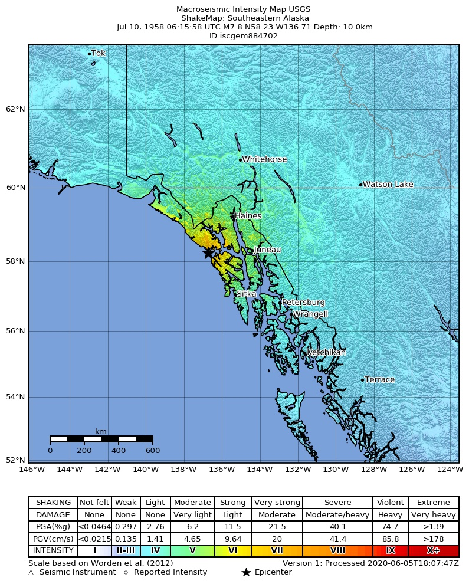

# LituyaBay1958
  

## Thema

[Tsunami](https://en.wikipedia.org/wiki/1958_Lituya_Bay_earthquake_and_megatsunami)  

## Datensammlung

BBox festgelegt (UTM Zone 8 Nord, Einzelheiten in [Kartenmaterial.md](Kartenmaterial.md#1-gebiete-bbox)):

| Gebiet | UTM 8N Ost | UTM 8N Nord | Grad W, S, O, N |
|---|---|---|---|
| Kern (Bucht) | 340 000 – 364 000 | 6 494 000 – 6 512 000 | −137,7629 58,5570 −137,3381 58,7267 |
| Szene (Fairweather-Kette) | 322 000 – 388 000 | 6 480 000 – 6 540 000 | −138,0956 58,4244 −136,9189 58,9849 |
| Fern (Horizont) | 220 000 – 480 000 | 6 385 000 – 6 625 000 | −139,9734 57,5207 −135,3347 59,7624 |

Kartenmaterial: 48 Quellen von Lidar 2019 bis zur Karte von 1951 und den Vermessungen 1940/1959, Katalog in [Kartenmaterial.md](Kartenmaterial.md). Laden nach `download/`:

```bash
python tools/kartenmaterial/kartenmaterial.py laden
```
