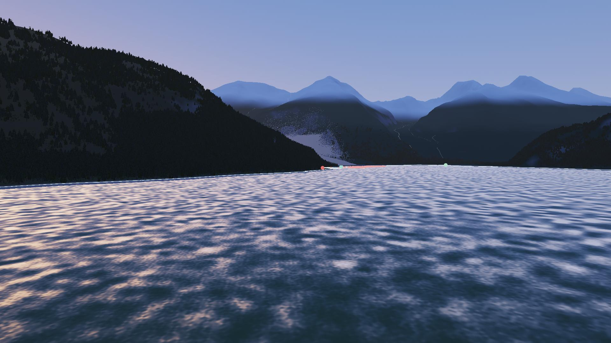
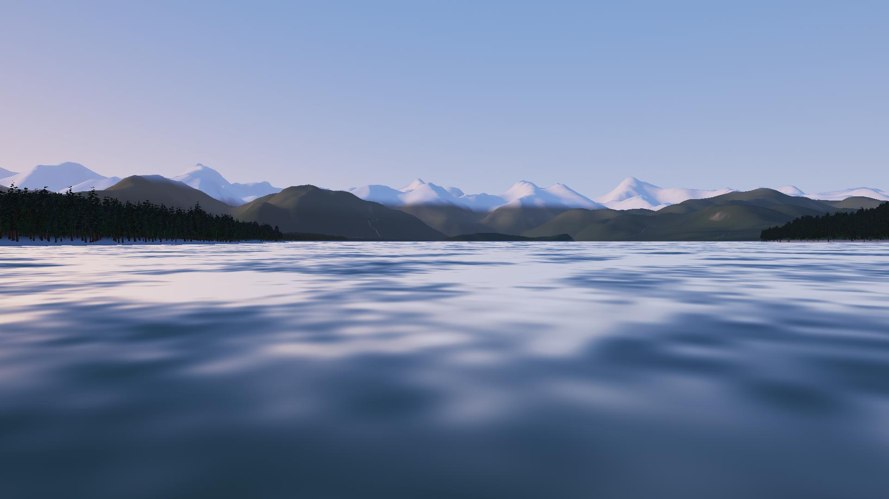
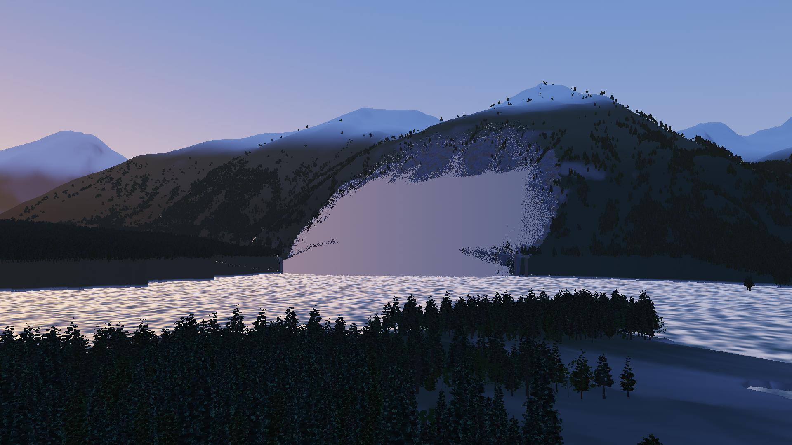
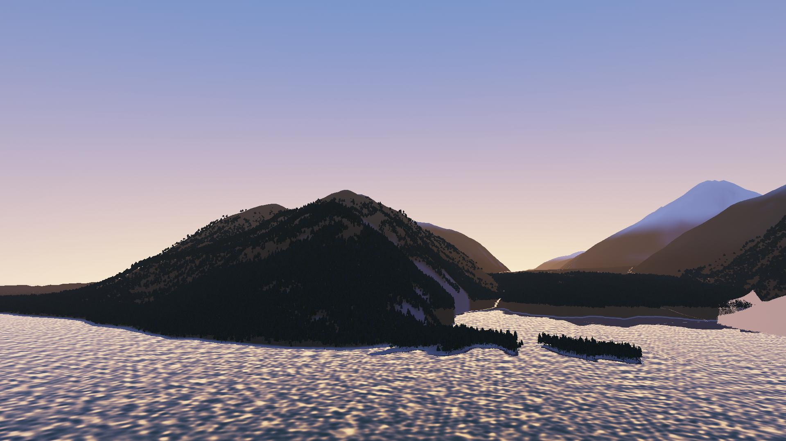
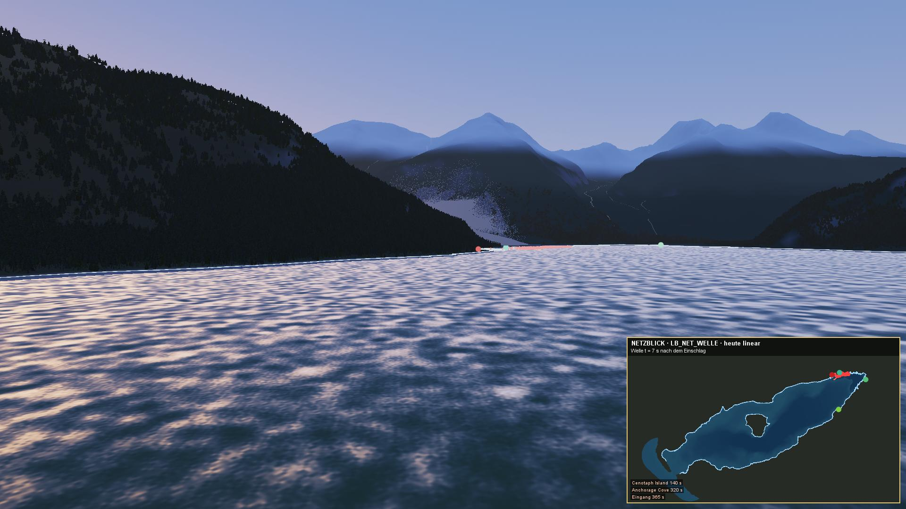
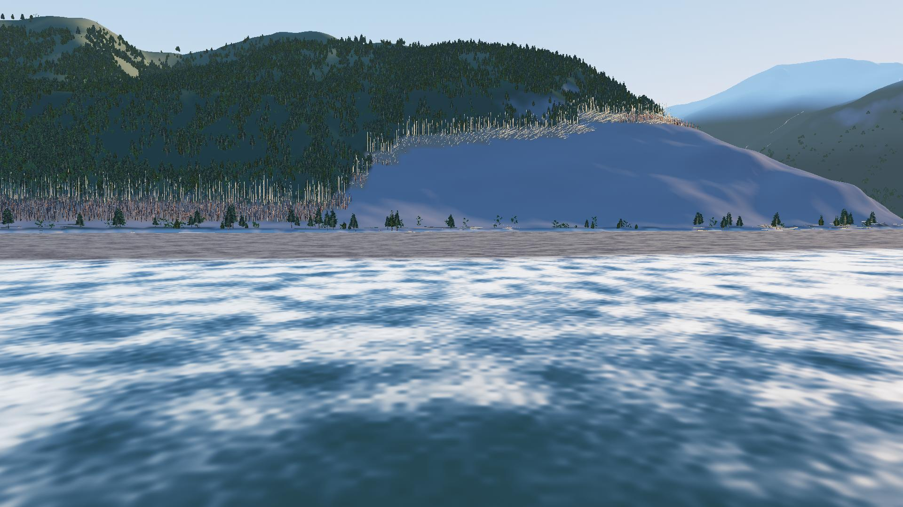
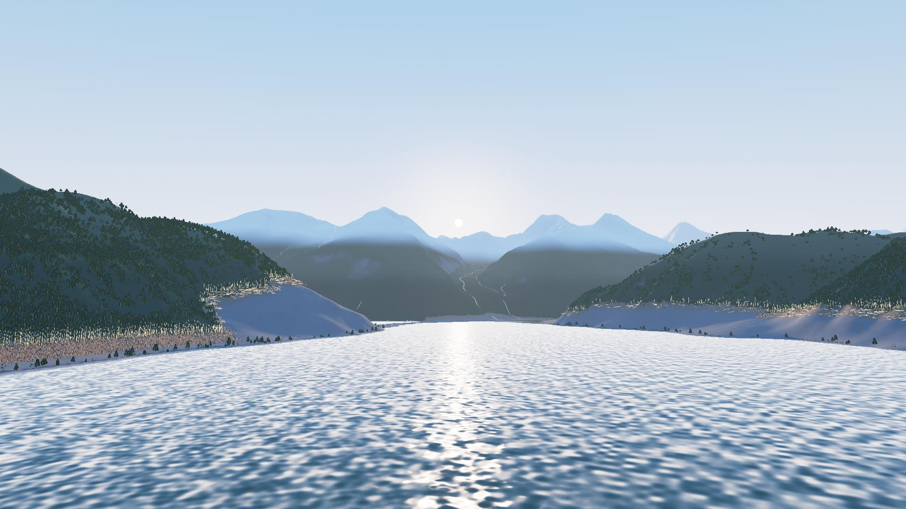

# LituyaBay1958 – das Projekt der Riesenwelle und des Netzes

Lituya Bay, Alaska, 9. Juli 1958, 22:16 Uhr Ortszeit: Das Beben an der Fairweather-Störung (Mw 7,8) löst am Gilbert Inlet einen Felssturz von 30,6 Mio. m³ aus. Die Welle läuft am Sporn gegenüber bis 524 m hinauf und die 12 km lange Bucht hinab bis zu den drei Kuttern am Eingang. LituyaBay1958 zeigt die Bucht als animierte 3D-Echtzeitszene vor, während und nach der Welle und heute. Die Ereigniskette ist als Physik in neuen Packages des Projekts Renderer gerechnet, dazu kommen sieben Netze im Oracle Network Data Model.

**Stand: Phase 20 von 20, fertig (03.11.2026), Version 1.0.** Plan, Entscheidungen, Befunde und Fortschritt stehen im Werkbuch [`docs/claude/LITUYABAY1958_WERKBUCH.md`](docs/claude/LITUYABAY1958_WERKBUCH.md). Als Nachträge benannt, aber nicht gebaut: 18c (Leben in der Szene: Bären, Adler, Seeotter), 18b (Wetter, Polarlicht), 10b (Wasser im Gleitkörper), 6a (Unterwuchs, Gletscher, `scree`) und die Aufbereitungsschritte `rueckbau1958` und `spurlinie`.

## Was man sieht

| | |
|---|---|
|  **Abend vor Anker**, 22:00: die Edrie in der Anchorage Cove, die helle Julinacht |  **Die Wand aus Wasser**: der Sturz trifft den Gilbert Inlet, Staub und Strom |
|  **524 m**: der Auflauf am Sporn, der Wald wird abrasiert |  **Netzblick**: Isochronen aus `LB_NET_WELLE` als Bild im Bild |
|  **Der Morgen danach**: das helle Band, Treibgut in der Bucht |  **68 Jahre**: der Wald wächst ins Band zurück (heute) |

Die Bilder schreibt `ant readmebilder` neu (ohne HUD, Stufe Hoch).

- **Vier Zeitstände:** vor der Welle, die Welle, danach (10. Juli 1958) und heute, dazu der Jahres-Zeitraffer von 1958 bis 2026 mit der Wiederbewaldung.
- **Die Ereigniskette:** Beben (`quake`), Felssturz (`landslide`, `fracture`), Eintauchen (`impact`, SPH im Schnitt), Welle in der Bucht (`wave.Bay` auf dem Grund von 1958, auf dem Prozessor und als Compute Shader), Staub und Treibgut (`dustcloud`, `debris`), Boote (`vessel`: Edrie, Badger, Sunmore) und Wellenwurf im Wald (`succession`, `forest`). Lauf `kette`: Auflauf am Sporn 514 m (belegt 524 m), die Front an Cenotaph Island nach 227 s, in der Anchorage Cove nach 415 s und am Eingang nach 433 s.
- **Abspielen und „Was wäre wenn“:** Die vorgerechneten Läufe laufen vorwärts, rückwärts und in Zeitlupe. Die Echtzeit rechnet die Welle neu mit eigenem Volumen, Ort, Tide und Grund (1940 gegen heute); Strg + Klick setzt den Ort des Sturzes.
- **Klang:** Grollen, Sturz, Brecher, Bäume und Echo, jeweils mit der Laufzeit des Schalls zur Kamera.
- **Sieben Netze** (Oracle NDM, als Datei auch ohne Datenbank): `LB_NET_HERKUNFT` (woher jede Datei kommt), `LB_NET_WELLE` (Laufzeit der Front), `LB_NET_UFER` (Spurlinie je Ufermeter), `LB_NET_SEE` (Wege der Boote), `LB_NET_WASSER` (Bäche und Gletscher), `LB_NET_WEG` (zu Fuß über das Gelände, Flucht an Land) und `LB_NET_SICHT` (Kamerapunkte, Rundflug, Kamerafahrt).
- **Regiebücher im Kino:** „Zehn Minuten“, „Die drei Boote“, „Die Nacht der Welle“, „68 Jahre“, „Die Bucht der Wellen“, „Die Bootstour“. Eigene Regiebücher schreibt und prüft man im Archiv.
- **Archiv (F2):** Befunde mit Quellen als Marken in der Szene, Aussagen der Zeugen als Untertitel zur Zeit, Läufe im Vergleich, Bildergalerie mit „Kamera hierhin“, Sitzungen. Alles liegt in Oracle (`db/szene`) oder ohne Datenbank in `daten/speicher`.

## Starten

- **Voraussetzungen:** JDK 21, OpenGL 4.3 (gebaut und abgenommen auf einer AMD Radeon 680M), 16 GB RAM oder mehr, `daten/` aus der Aufbereitung (rund 15 GB). Oracle 21c ist wahlweise: Ohne Datenbank liest die App die Netze aus `daten/netz` und speichert in `daten/speicher`.
- **NetBeans:** Projekt öffnen, **Clean and Build**, dann **Run** (Hauptklasse `com.dan.lituya.app.LituyaApp`). In `lib/` liegen `Renderer.jar` (aus dem Projekt Renderer, nicht im Git), JOGL mit den Natives für Windows, `FStyle.jar`, `ojdbc11.jar`, `sdoapi.jar`, `sdogr.jar`, `sdoutl.jar` und `sdonm.jar`.
- **Verknüpfung:** `ant symbol` (das Programmsymbol nach `icon/LituyaBay1958.ico`), dann `ant verknuepfung`. Das legt `start.cmd` im Projektordner und je eine Verknüpfung „Lituya Bay 1958“ auf dem Desktop und im Startmenü an (javaw ohne Konsole, mit Symbol; `-Dwo=desktop|startmenue|beide`). Startfehler ohne Konsole stehen in `daten/fehler.txt`.
- **Datenbank:** Den Zugang trägt man in `db/db.properties` ein (Vorlage `db/db.properties.example`). Ist das Passwort leer, fragt das Startbild danach (oder die Umgebungsvariable `LituyaBay1958_DB_PASSWORD`). Einmal als SYS `db/netz/00_sys.sql` ausführen, dann `ant netzdb` (Netze) und `ant szenedb` (Befunde, Zeugen, Boote, Läufe, Regiebücher, Sitzungen, Bilder).

## Bedienung

- **Maus:** Links ziehen dreht, rechts ziehen verschiebt, das Rad zoomt. Ein Klick auf eine Marke wählt den Befund im Archiv.
- **Tasten:** W A S D gleiten, Q/E ab und auf, F frei fliegen, R kreisen, 0 bis 9 die Ansichten, Pos1 die Grundansicht. Leertaste hält die Uhr an, J K L spielen rückwärts, halten an und spielen vorwärts, Z ist Zeitlupe, Y der Jahres-Zeitraffer. N schaltet den Netzblick, M den Klang, H das HUD. F1 Hilfe, F2 Archiv, F11 nur die Szene, F12 Foto, F5 Shader neu laden, Strg+S Sitzung sichern.
- **Bedienfeld:** ANSICHT, KAMERA, MALWEISE, ZEIT, EREIGNIS (Schaustücke 1 bis 12, Wiedergabe, Echtzeit, Boote), NETZE, WETTER, POLARLICHT, KLANG, REGIEBÜCHER, DATEN, TECHNIK.
- **Malweise (Werkbuch Welle W10):** Im Block MALWEISE wird die Szene nach Franz Gertsch (`com.dan.gertsch`) gemalt. „Gertsch: der Wald ringsum“ malt die Bäume im Umkreis der Kamera. Es sind dieselben Bäume wie im Wald der App, dazu der Unterwuchs aus `understory`. Gemalt wird Fleck für Fleck in den Tonstufen einer Vorlage, ohne Himmel. „Gertsch als Holzschnitt“ druckt dieses Bild wie Gertschs Holzschnitte, „Holzschnitt der ganzen Szene“ jede Ansicht. Bäume, Unterwuchs und Kamera stehen auf dem echten Gelände (seit W10a); seit W10b mit Flechten auf Rinde und Ästen und mit der Bucht als Wasser unter dem Pegel. `ant malweisefenster` prüft den Block im echten Fenster. Gemalt wird bis 120 m über Grund. „In den Wald“ stellt die Kamera an den Boden bei Fish Lake. Standbilder entstehen mit `-Dmalweise=gertsch|gertschstich|stich` in `Tempo` oder in der Bildbank (`src/com/dan/lituya/scene/aufnahmen_w10.txt`).
- **Die Bootstour (Werkbuch Welle W11):** Die Edrie läuft am 9. Juli 1958 um 20 Uhr mit der letzten Flut ein (belegt), fährt die Bucht hinauf bis vor den Gilbert Inlet und zurück und ankert am Südufer, wo um 22:15 die Bahn der Welle beginnt [G]; heute fährt die KITTIWAKE dieselbe Route ab 10 Uhr. `ant bootstour` rechnet die Bahnen (`vessel` mit Autopilot auf einer Route aus `LB_NET_SEE`) nach `daten/ereignis/boote/tour`. Fahrende Boote ziehen ein Kielwasser aus `com.dan.wake` (Kelvin-Keil, Schaumspur der Schraube), die See spart den Rumpf aus (Schaumsaum), am Steven steht die Bugwelle, der Diesel ist zu hören. Schaustück 12 hängt die Drohne an die Edrie; im Regiebuch „Die Bootstour“ und in eigenen Büchern: `drohne edrie seite|achtern|ueberholen|kreisen [Abstand [Höhe]]`, `mitfahrt edrie bug|steuerhaus|achtern`, `tour edrie|kittiwake|aus`.
- **Das Polarlicht (Werkbuch Welle W12):** Im Block POLARLICHT steht das Nordlicht aus `com.dan.aurora` hinter dem Himmel, auch im Spiegel der See. Lituya Bay liegt bei 61,9° magnetischer Breite: ab Kp 4 stehen die Vorhänge über der Bucht, bei Kp 2 ein ruhiger Bogen im Norden hinter der Kette. Presets ruhig, aktiv, Aufbruch (Kp 6, drei gefaltete Vorhänge mit purpurnem Saum) und rot, oder nach dem Kp-Regler; Feinregler für Energie (weich leuchtet rot in 200 bis 300 km, hart grün um 100 km), Fluss, Faltung und Strahlen; Drift und Falten in Bewegung; „Farben wie die Kamera“ lässt das Stäbchensehen der Nachbearbeitung aus (sonst wird das Grün blaugrau, wie das Auge es bei Nacht sieht). Datum und Weltzeit kommen aus der Uhr der Szene: im Juli 1958 sinkt die Sonne nie unter −12°, das Polarlicht geht im Himmelslicht unter, und der Block sagt es; „Winternacht“ stellt die Uhr auf den 20.12.2026, 23 Uhr, „Blick zum Bogen“ die Kamera zum hellsten Bogen. `ant polarlichtfenster` prüft den Block im echten Fenster. Standbilder mit `-Daurora=ruhig|aktiv|aufbruch|rot|<Kp>` (dazu `kp`, `energie`, `fluss`, `faltung`, `strahlen`, `zumbogen=an`) in `Tempo` oder in der Bildbank (`src/com/dan/lituya/scene/aufnahmen_w12.txt`).
- **Hilfe (F1):** Tasten, Ansichten und Schaustücke, Bedienfeld, Archiv, Regiebücher schreiben, Datenstand, alle ant-Ziele und die Kapitel des Werkbuchs.

## Film, Qualität, Dauerlauf

- **`ant film -Dbuch="Zehn Minuten"`** spielt ein Regiebuch ohne Fenster im Kino, mit festem Zeitschritt und dem Klang an der Kamera. Daraus wird `docs/film/<Name>.mp4` (H.264 mit AAC; `-Dqualitaet=HOCH`, `-Dpreset=slow` für die beste Güte, `-Dbis=30` zum Probieren). ffmpeg kommt aus dem PATH oder `-Dffmpeg=…`; ohne ffmpeg entstehen PNG-Bilder und ein WAV, dazu die Zeile zum Nachholen.
- **`ant qualitaet`** misst die Zeit je Bild in den Stufen Niedrig, Mittel, Hoch und Ultra in drei Ansichten. Die Tabelle steht in `docs/status/qualitaet_Phase20.txt` und im Werkbuch 15.
- **`ant dauerlauf -Dminuten=480`** spielt alle Regiebücher immer wieder im Kino und schreibt je Minute Bildrate, Speicher und Grafikspeicher. Am Ende prüft es: kein Fehler, kein wachsender Speicher, keine einbrechende Bildrate.
- **`ant pruefung`** läuft ohne Grafikkarte und Datenbank und endet mit „ERGEBNIS: alles in Ordnung“.

## Daten und Kartenmaterial

Das Kartenmaterial (48 Quellen, rund 1 250 Dateien, 13,8 GB; Katalog in [`Kartenmaterial.md`](Kartenmaterial.md)) lädt `python tools/kartenmaterial/kartenmaterial.py laden` nach `download/`. Nur die Aufbereitung (`ant aufbereitung`) liest es und schreibt nach `daten/` mit `daten/INHALT.txt` (SHA-256 je Datei). App, Netze und Oracle lesen nie aus `download/` (Werkbuch 3.3).

Zum Auslagern auf eine Wechselfestplatte:

1. `ant auslagerung` prüft `daten/` gegen `INHALT.txt` und Regel 3.3 und schreibt [`docs/QUELLEN.md`](docs/QUELLEN.md), den Ort jeder Rohdatei.
2. `download/` verschieben, etwa mit `robocopy download E:\LituyaBay1958_Kartenmaterial /E /MOVE /XF INVENTAR.md`.
3. `ant auslagerung -Dziel=E:\LituyaBay1958_Kartenmaterial` prüft das Ziel und trägt es in `daten/rohdaten.properties` ein.
4. `ant auslagerungsprobe` lässt Prüfung und Statusbild bei umbenanntem `download/` laufen.

## Raum und Zeit

UTM Zone 8 Nord (NAD83, EPSG:26908), Höhen über NAVD88. Der Ursprung liegt in der Mitte des Kerns bei E 352 000, N 6 503 000: x nach Osten, z nach Süden, y nach oben. Die Gebiete: Kern 24 × 18 km, Szene 66 × 60 km, Fern 260 × 240 km (`geodaten/gebiete.geojson`). Die Ortszeit 1958 ist UTC−8 (PST), der erste Stoß um 22:16 also der 10.7.1958 06:16 UTC. Die Sonne ging am 9.7.1958 um 22:14 unter.

## Packages im Projekt Renderer

Gebraucht werden 26 vorhandene Packages (`wave`, `fracture`, `forest`, `ocean`, `sky`, `soundscape`, `kino`, `route`, …). Neu für LituyaBay1958 sind `clipmap` (Gelände bis zum Horizont), `surface` (Materialien), `understory`, `netview` (Netzblick), `quake`, `landslide`, `impact`, `dustcloud`, `debris`, `succession`, `vessel` und `bear`. Jedes hat eine README und eine Prüfklasse; `ant check-packages` prüft `lib/Renderer.jar`. Noch offen ist `scree` (6a); `aurora` (18b) kam am 09.11.2026 mit Welle W12 (Polarlicht auf Prozessor und Grafikkarte).

## Quellen

Die Belege (Miller 1960, Fritz u. a. 2001, die Zeugen, Vermessungen 1926, 1940 und 1959) stehen im Werkbuch 2, die Befunde mit Quellen in `src/com/dan/lituya/data/befunde.tsv` und `quellen.tsv` (in der App im Archiv). Die Texturen sind CC0 von ambientCG.
